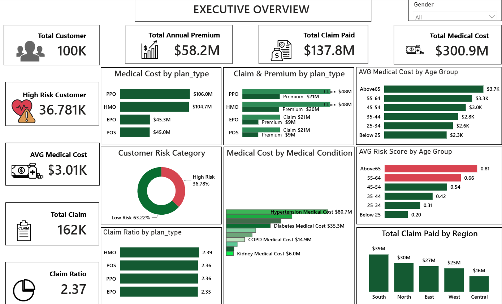
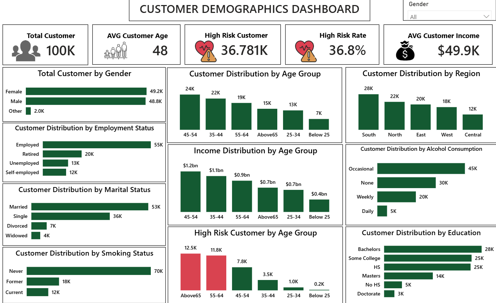
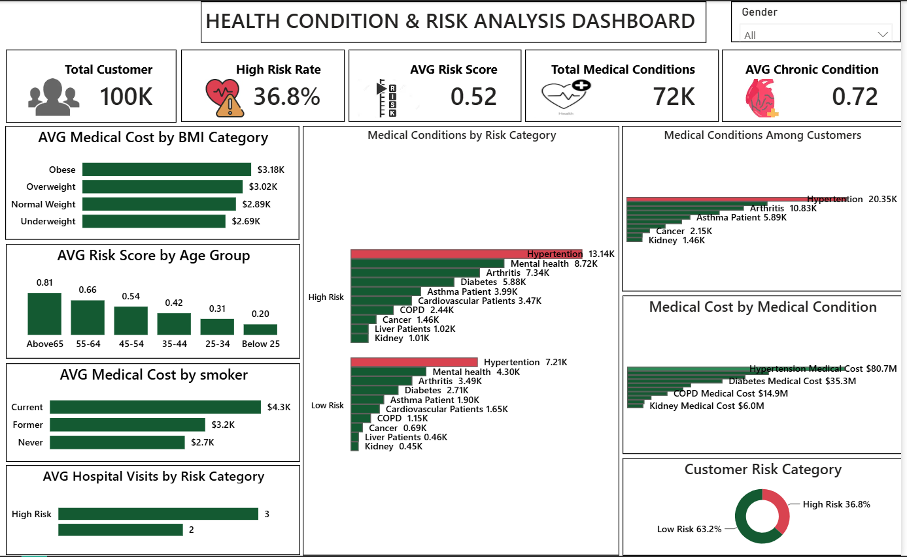
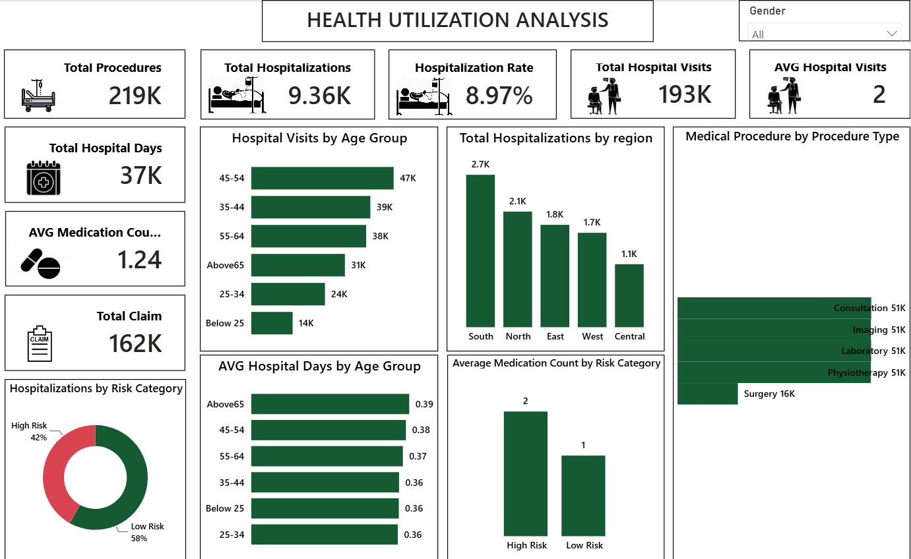
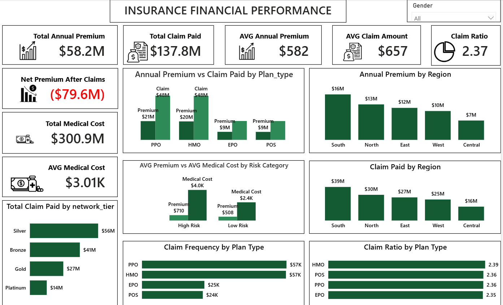
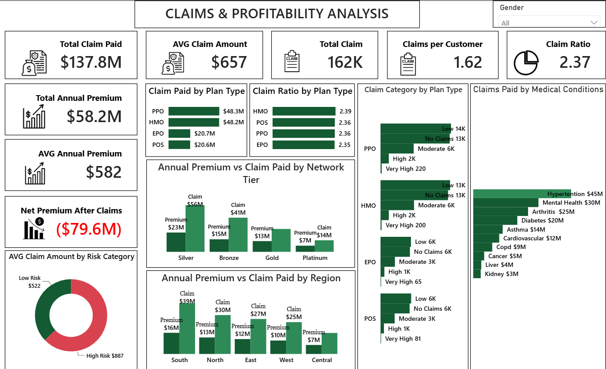

# MEDICAL INSURANCE ANALYSIS w/ Power  BI / MySQL

## Introduction

This project focuses on analysing medical insurance data to uncover meaningful insights into customer demographics, health conditions, healthcare utilisation, claims and insurance financial performance.

Using a dataset containing approximately 100,000 customer records, the project explores customer characteristics, identifies high-risk populations, examines medical conditions and healthcare service utilisation, and evaluates the relationship between insurance premium revenue and claims expenditure.

The analysis was conducted using MySQL and Microsoft Power BI, with data exploration, transformation, analytical calculations and interactive visualisations used to convert raw data into actionable business intelligence.

## Skills Showcased

-  **Data Transformation (ETL) with Power Query:** Cleaned, shaped and prepared the raw data for analysis by handling blanks, changing data types and creating new columns.
- **DAX Calculations:** Formulated measured to derive key insight and KPIs.
-  **Core Chart:** Utilized **Column, Bar** and **Donut Charts**.
- **KPI Indicator :** Used **Cards** to display key metrics.
- **Dashboard Design:** Designed an intuitive and visually appealling layout, exploring both common and uncommon chart types to best tell the data story.
- **Interactive Reporting:**
  - **Slicers:** To dynamically filter the report by year.
  - **Bookmarks:** To create a seamless navigation experience.

## Tools and Technologies

-  **MYSQL:** Data exploration, querying and analysis
-  **Microsoft Excel:** Data inspection and preliminary  analysis
-  **Power Query:** Data cleaning and transformation
-  **Power BI:** DAX calculations and interactive dashboard development

  ## Dashboard Overview

  ### Page 1: Customer Demographics Analysis

  
    The Customer Demographics Analysis reveals that the company serves approximately 100,000 customers, with a relatively balanced gender distribution and a customer base largely concentrated among individuals aged 35–64. The South region has the highest customer representation, while employed individuals and married customers constitute the largest demographic segments.

A major finding is that approximately 36.8% of the customer population is classified as high-risk. Customers aged 65 and above, as well as those aged 55–64, account for the largest share of this population, highlighting the importance of targeted healthcare management and preventive intervention for older customers.

 The analysis also identifies opportunities for business expansion through younger customer acquisition and regional market development. Additional opportunities exist in corporate partnerships and family-oriented insurance packages.

Overall, the findings provide management with valuable insights for customer segmentation, healthcare risk management, product development and strategic business planning.

  
  ### Page 2: Health Condition & Risk Analysis

    

 The Health Condition and Risk Analysis reveals that approximately 36.8% of the company's 100,000 customers are classified as high-risk, highlighting a significant healthcare risk management concern. The analysis identifies a clear increase in average risk scores with age, with customers above 65 recording the highest average score of 0.81.   

Hypertension emerges as the most prevalent medical condition, accounting for approximately 20.35K recorded occurrences and 80.7M in associated medical costs. Diabetes also represents a significant financial burden, with associated medical costs of approximately 35.3M. Furthermore, current smokers record the highest average medical cost at 4.3K, compared with 2.7K among customers who have never smoked.

The analysis also reveals that high-risk customers average three hospital visits, compared with two among low-risk customers, indicating greater healthcare utilisation within the high-risk population.

  ### Page 3: Health Utilization Analysis
     

  

  The Health Utilization Analysis reveals significant healthcare service demand across the company's customer population of approximately 100,000 individuals. The analysis records 193K hospital visits, 9.36K hospitalisations, 37K hospital days and 219K medical procedures, with an overall hospitalisation rate of 8.97%.

  Customers aged 45–54 recorded the highest number of hospital visits at approximately 47K, highlighting substantial healthcare utilisation among middle-aged customers. The South region also recorded the highest hospitalisation volume, with approximately 2.7K cases, indicating geographical differences in healthcare demand.

  Furthermore, high-risk customers use approximately two medications on average, compared with one among low-risk customers, suggesting greater medication requirements within the high-risk population. Customers above 65 also recorded the highest average hospital days at 0.39.

  ### Page 4: Insurance Financial Performance Analysis

  

  The insurance company is experiencing significant financial pressure, with total claims paid of $137.8 million against annual premium income of $58.2 million, resulting in a negative net premium position of $79.6 million.

  The analysis identifies PPO and HMO as the plans with the highest claims expenditure and frequency, while the South region records the highest claims paid. Additionally, both high-risk and low-risk customer categories generate medical costs that exceed their average premiums. 

  ### Page 5: Claims & Profitability Analysis

  

  The Claims and Profitability Analysis reveals that the company is experiencing significant financial pressure, with total claims paid of $137.8M against annual premium income of $58.2M, resulting in a negative net premium position of $79.6M.

  The analysis identifies PPO and HMO as the largest contributors to claims expenditure, while hypertension, mental health, arthritis and diabetes are the leading reported medical cost drivers.

   High-risk customers also generate substantially higher average claims than low-risk customers, while the South region and Silver and Bronze network tiers account for significant portions of claims expenditure.

## Conclusion

The Medical Insurance Data Analysis project demonstrates how data analytics can support better decision-making within the healthcare insurance industry.
The findings highlight the importance of preventive healthcare, effective customer segmentation, chronic disease management, healthcare resource planning and continuous monitoring of claims expenditure.
Overall, the project demonstrates the value of transforming raw medical insurance data into actionable business intelligence that can support improved healthcare management, operational efficiency and informed strategic planning.

## Author

**AKINLADE OLUWATOBILOBA**

 DATA ANALYST | BUSINESS INTELLIGENCE